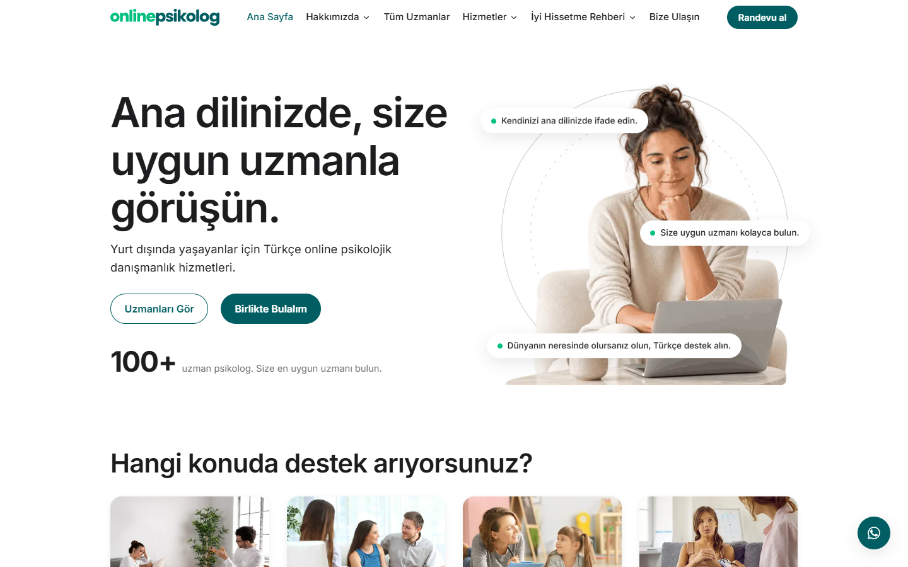
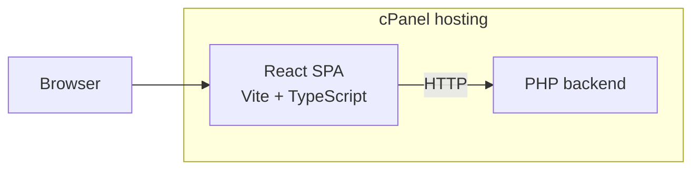

<picture>
  <source media="(prefers-color-scheme: dark)" srcset="assets/header-dark.svg">
  
</picture>

**Live at [onlinepsikolog.org](https://www.onlinepsikolog.org/)**

Online Psikolog is a web platform where clients find a psychologist and book an appointment. I built it as a freelance project with a React front end and a PHP backend, and I run its deployment and server operations on cPanel.

> This is a showcase repository. Online Psikolog is a client project, so its source code is private; this page describes what the platform does and how it is built.

<!--
## Screenshots

Add PNGs to docs/screenshots/ and uncomment this section.

  
  

-->

## What it does

- Specialist listings with an individual profile page for each psychologist.
- An appointment system for booking sessions.
- Blog management for publishing articles.
- A fully responsive interface for phones, tablets and desktops.

## How it works

The front end is a single-page React app written in TypeScript, built with Vite and routed with React Router. The production build is served from cPanel hosting alongside the PHP backend, which handles appointments, specialist data and blog content.

## Tech stack

React · TypeScript · Vite · React Router · Framer Motion · PHP · cPanel

## Running it

The source code is not public, so the site cannot be built from this repository. To see it in action, visit [onlinepsikolog.org](https://www.onlinepsikolog.org/).

## Contact

Ulaş Uçan · [LinkedIn](https://www.linkedin.com/in/ula%C5%9F-u%C3%A7an-36531626b) · [uls.ucn@gmail.com](mailto:uls.ucn@gmail.com)
